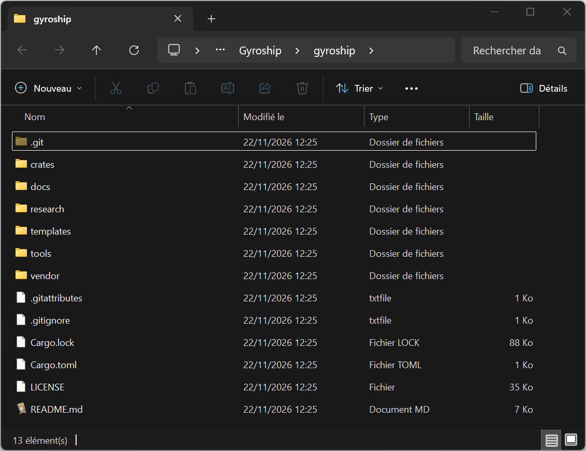
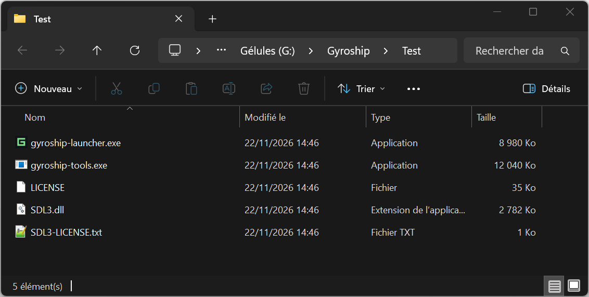
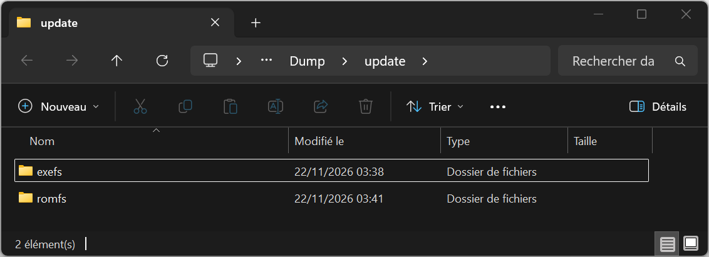
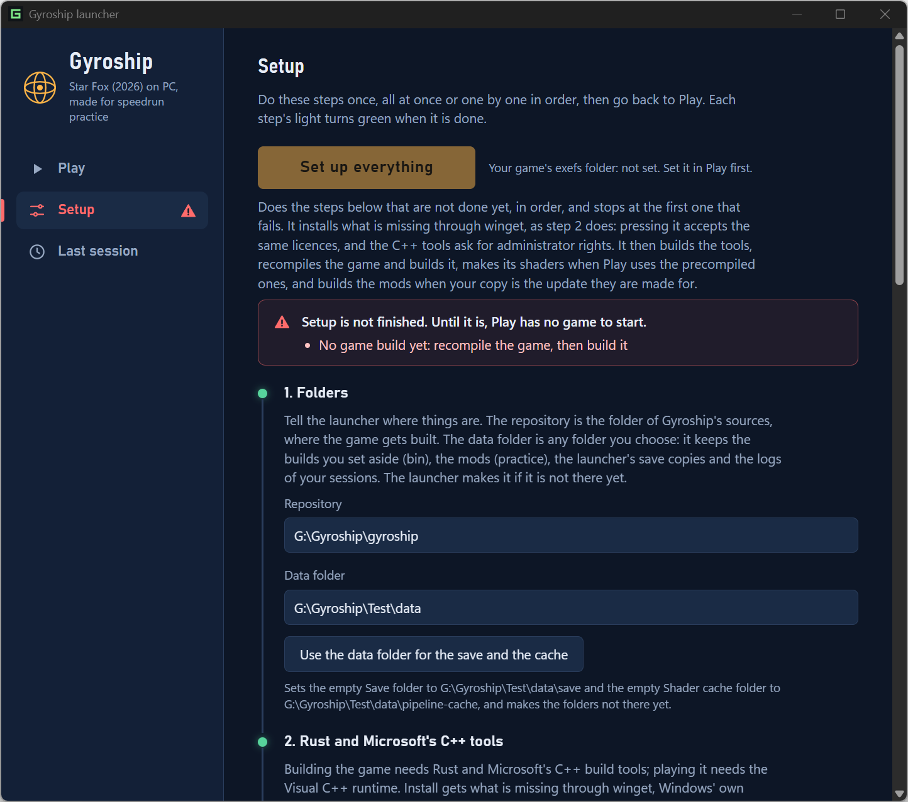
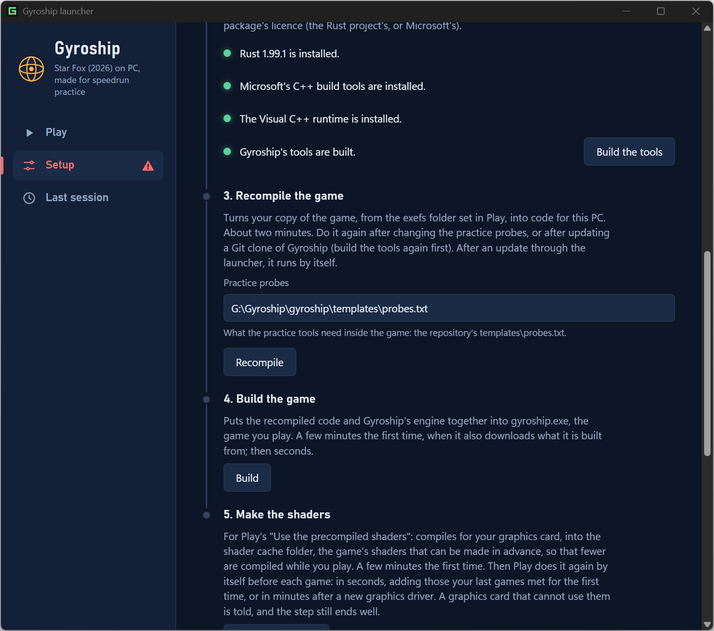
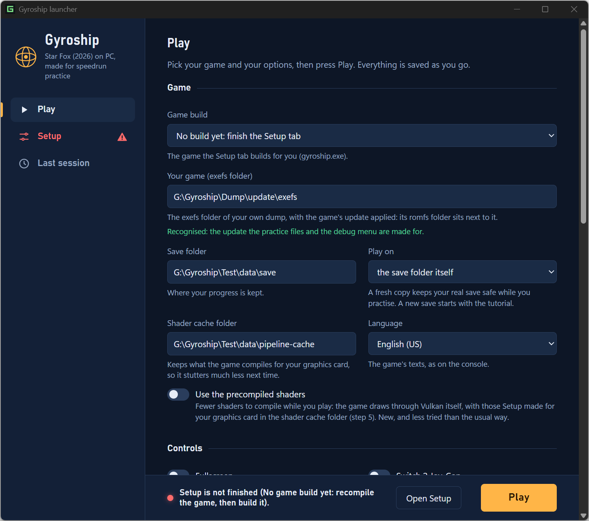
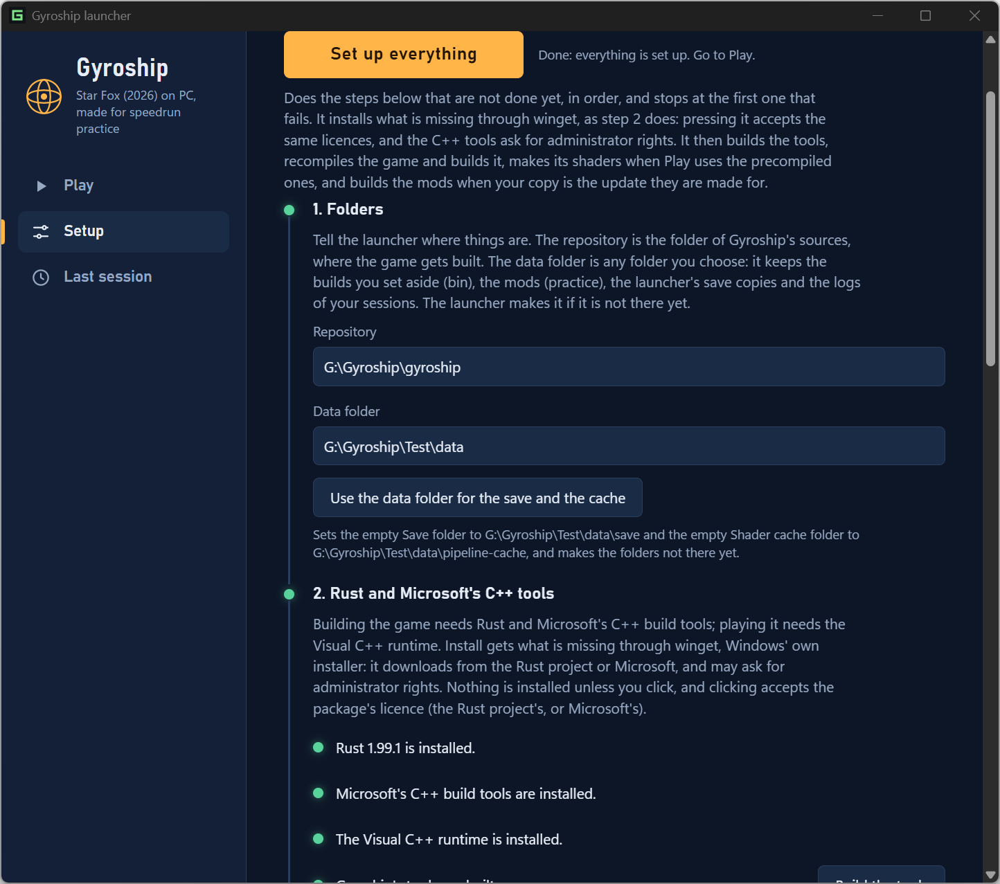
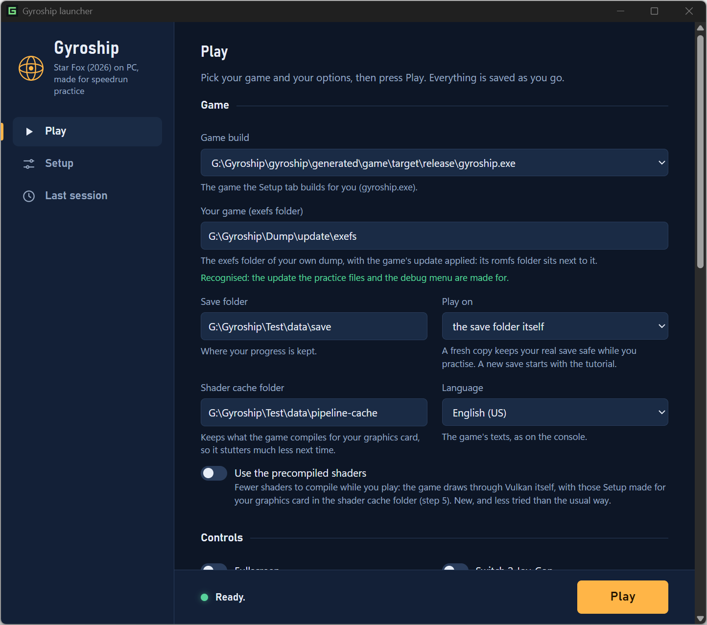

# Gyroship

**Star Fox (2026) on your PC with the practice tools and mods a speedrunner dreams of.**

Gyroship turns your own copy of Star Fox for Nintendo Switch 2 into a real Windows program, at 60
fps. Then it goes further than a port: a boost that lets go at the perfect moment,
your speed and release markers on screen, the level time to the millisecond, the game's own debug
menu with mission select and cheats, mods that swap your vehicle, and Switch 2 Joy-Con with their
mouse controls.

You bring the game: your own dump, from your own console, as the plain `exefs` and `romfs` folders
of the game and its update. NUP files and other unofficial formats are not supported. Gyroship
holds no game code or assets and decrypts nothing, the game never goes online, and what you build
from your dump stays yours alone. It is for practice: official runs are done on the console.

## What makes Gyroship different

| | |
|---|---|
| 🎯 **Speedrun practice** | Perfect boost release, infinite boost, speed and release markers on screen, the level time to the millisecond |
| 🧩 **Mods** | Another vehicle in a mission, QUIT GAME, the game's mission timer, the eShop demo's lines, a shortcut to the tutorial's mouse lesson |
| 🛠️ **The developers' debug menu** | Mission select, and the shield, wings, bombs, lives and laser cheats, with any mod |
| 🎮 **Switch 2 Joy-Con** | Straight over Bluetooth, no pairing in Windows: hold sync and play |
| 🖱️ **Mouse controls** | Each Joy-Con becomes the mouse the game expects, as on the console |
| 🔬 **Research you can check** | The boost of each vehicle, taken from the game's code and matched to the running game, bit for bit |

## Practice like no console lets you

Every practice tool is a switch in the launcher, and the files they need for the game's update come
with Gyroship: no reverse engineering.

- **A perfect boost, every time.** Hold Boost and each boost ends where the research says to let
  go, in the Arwing and the Blue-Marine. One button turns it off when you want a full boost.
- **An infinite boost**, to learn a route without watching the meter.
- **Your speed, the frame rate, the release markers**: pick any of them, and they show over the
  game, in its own font and language. The markers sit in the boost bar, right where to let go.
- **The level time in milliseconds**, frame by frame (the game counts sixtieths of a second), on
  the results screen and in the game's mission timer.
- **Mission select and cheats** from the game's own debug menu: jump straight to the part you
  practise, with the shield, wings, bombs and lives you want.
- **Record your inputs** and replay them.

Why let go at a third of the meter in the Arwing, at a fifth in the Blue-Marine, and never in the
Landmaster?
[research/boost/README.md](research/boost/README.md) explains each vehicle's boost, from the game's
own code, with the numbers to prove it.

## Mods

- **Swap your vehicle**: the Landmaster or the Blue-Marine in the Arwing's missions, the Arwing in
  theirs.
- **QUIT GAME**, in the title menu and in the pause menu.
- **The game's mission timer** on screen, to the millisecond.
- **The eShop demo's menu lines** in the full game.
- **The tutorial's mouse lesson in a minute or two**, to practise the mouse controls.

The launcher's Setup builds them from your own copy of the game, in a few seconds: nothing of the
game comes with Gyroship. Pick a mod in the launcher and play; with the debug menu box ticked, the
mods' QUIT GAME also works from the title menu.

## Switch 2 Joy-Con and mouse controls

Gyroship talks to Switch 2 Joy-Con itself, over Bluetooth: no pairing in Windows, no extra driver.
Turn your Switch 2 off, hold each one's sync button when the game starts, and play. Turn on mouse mode and each Joy-Con also
becomes a mouse, exactly as the game expects on the console: its mouse lesson, its mouse aiming,
its options. Xbox, PlayStation and other gamepads work too, and so does the keyboard.

## The whole game

- **A steady 60 fps** on both PCs it was tested on: a desktop with an Intel Core i9-9900K, a
  GeForce GTX 1080 and 16 GB of RAM, and a Shadow cloud PC with 4 cores of an AMD EPYC 7543P, an
  NVIDIA RTX A4500 and 28 GB of RAM.
- **The tutorial, the menus and every mission**, recompiled ahead of time into native code for
  your PC.
- **A launcher that guides you**: it prepares the game step by step, tells you what is missing and
  explains every option.
- **Always up to date**: when a new version of Gyroship is out, the launcher downloads it, checks
  it, installs it and builds your game again, by itself.
- **14 languages** for the game's texts, as on the console.
- **Offline**: the game talks to no server.

## What works today

| Part | |
|---|---|
| Native port | The game's code recompiled for your PC, its graphics on Vulkan |
| Frame rate | 60 fps, on both test PCs |
| Practice tools | Boost modes, on-screen speed, frame rate and markers, millisecond timer |
| Debug menu | Mission select and cheats, one box in the launcher |
| Mods | Built from your own copy by the launcher, then chosen in it |
| Controls | Keyboard, Xbox, PlayStation and other gamepads, Switch 2 Joy-Con |
| Mouse controls | Through the Joy-Con, as on the console |
| Sound and languages | The game's audio and its 14 text regions |
| Launcher | Setup step by step, then Play; it updates itself |

Details and known issues: [docs/status.md](docs/status.md).

## Install

You need Windows 11 (or Windows 10 with Microsoft's WebView2 runtime), 64-bit, an NVIDIA graphics
card, 16 GB of RAM, and your own dump of the game with its update. What building the game takes
(Rust, Microsoft's C++ build tools, the Visual C++ runtime), the launcher installs on your click
when it is missing. Here is one install from zero, on drive G:; any folders will do.

1. **Get the sources.** From the
   [latest release](https://github.com/Gelules/Gyroship/releases/latest), download
   `gyroship-<version>-source.zip` and unzip it, or clone this repository at that release's tag.
   Here: `G:\Gyroship\gyroship`, a clone.

   

2. **Get the programs** of the same release: unzip `gyroship-<version>-windows-x64.zip` in a
   folder of its own. It holds the launcher, the tools and `SDL3.dll` for gamepads and sound, with
   their licences: nothing to build. Here: `G:\Gyroship\Test`. The release's `SHA256SUMS.txt`
   holds both archives' SHA-256; `certutil -hashfile <archive> SHA256` prints an archive's, to
   compare.

   

3. **Find your dump's `exefs` folder**, the update's, with its `romfs` folder next to it. Here:
   `G:\Gyroship\Dump\update\exefs`.

   

4. **Start `gyroship-launcher.exe` and open Setup.** Windows may first warn that it does not know
   the program: More info, then Run anyway. In step 1, give the sources' folder as the Repository
   and a folder for your data (saves, shader cache, mods, logs) as the Data folder, then press "Use
   the data folder for the save and the cache": the launcher makes the folders. Here:
   `G:\Gyroship\Test\data`.

   

   For the practice tools, give step 3 the repository's `templates\probes.txt` as Practice probes:
   the game is then built with them from the start.

   

5. **In Play, give your dump's `exefs` folder.** The launcher tells you when it recognises the
   update the practice tools are made for.

   

6. **Back in Setup, press Set up everything.** It installs what is missing (you accept the
   packages' licences, and the C++ tools ask for administrator rights), recompiles the game from
   your dump (about two minutes), builds it (a few minutes the first time) and builds the mods from
   your dump (a few seconds), until it says Done.

   

7. **Press Play.** To practise, give Play the repository's `templates\practice.txt` as Practice
   file ([docs/practice.md](docs/practice.md)); to play with a mod, pick it in the Mod list.

   

When a new version is out, the launcher installs it by itself, its sources next to yours, and
builds your game again; from a clone, it only tells you (update it with `git pull`). Every option
of the launcher, and how to build everything
yourself: [docs/playing.md](docs/playing.md) and [docs/building.md](docs/building.md).

## Documentation

- [Building](docs/building.md): what to install, and the three programs to build.
- [Playing](docs/playing.md): the launcher, controls, gamepads and Joy-Con, the options to play
  with.
- [Practice tools and mods](docs/practice.md): the boost modes, what shows on screen, the debug
  menu, QUIT GAME, another vehicle in a mission.
- [Boost research](research/boost/README.md): each vehicle's boost, and when to let go.
- [Status](docs/status.md) and [verification](docs/development.md): what was tested, known issues,
  replays and tools for developers.

## License

Gyroship is free software: you can share and change it under the terms of the GNU General Public
License, version 3 or any later version ([LICENSE](LICENSE)).
