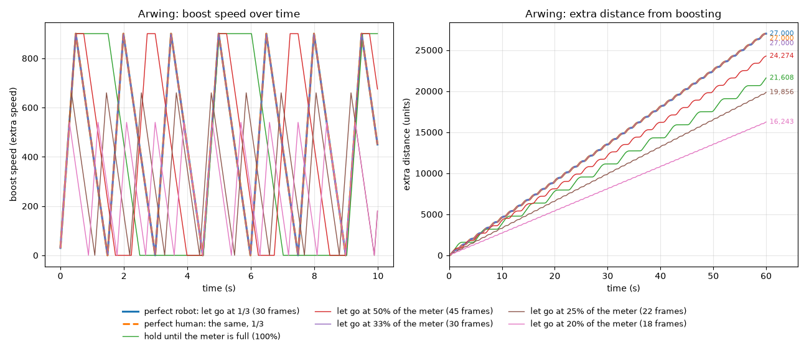
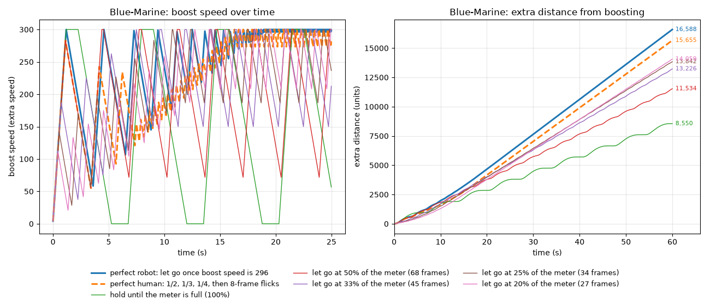
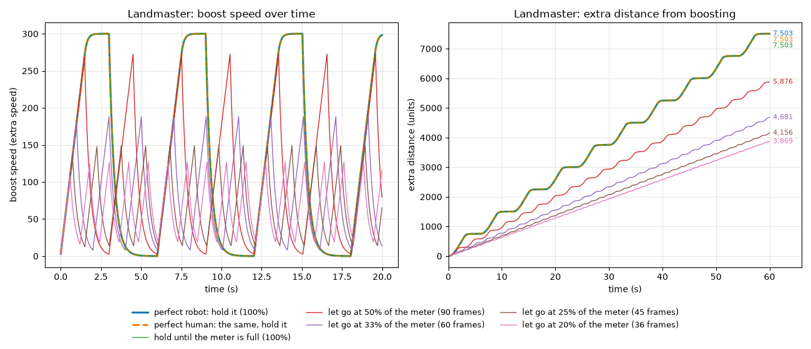
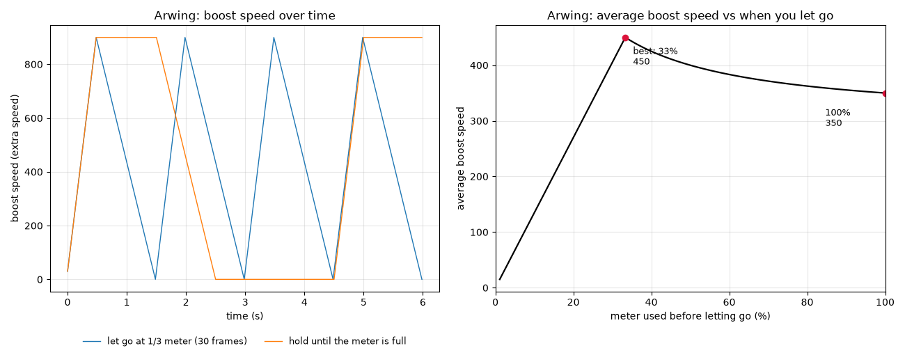
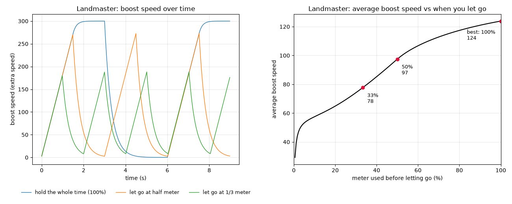
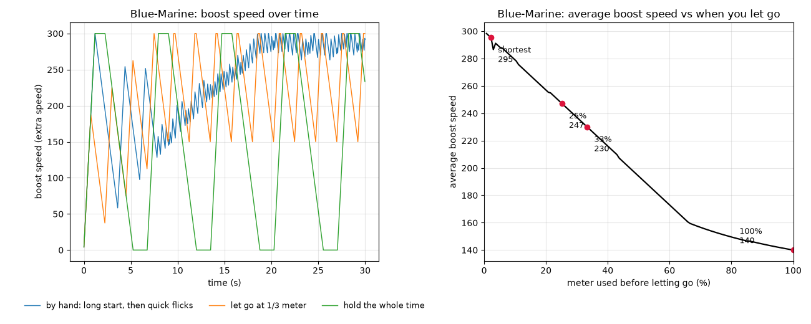
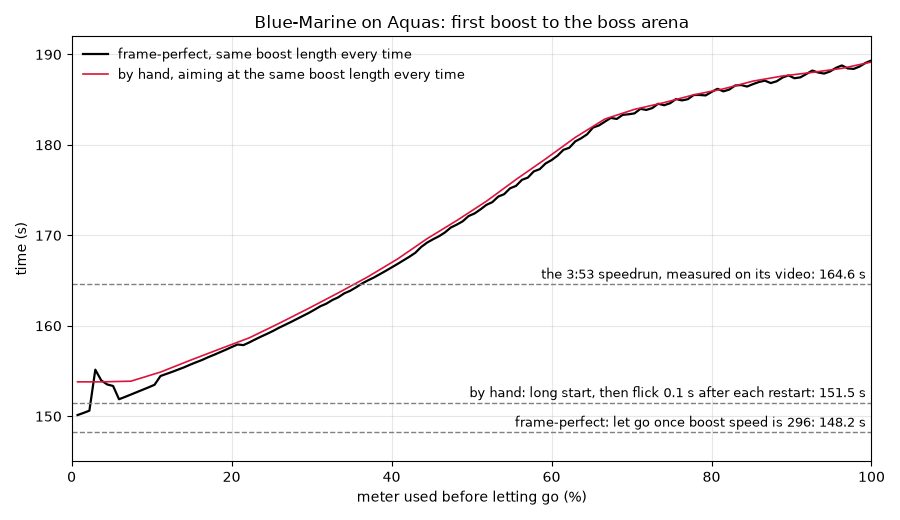

# The Science of Boost management in Star Fox (2026)

This follows up on [the earlier boost management guide](https://www.speedrun.com/sf2026/guides/ezzfs), which compared 25%, 33%, 50% and
100% boosts on video. This time the numbers come from the game itself: the boost values
of each vehicle were datamined from the game files.

## TL;DR

| Vehicle         | What to do                                                                                                                                                                                                                        | Why                                                                                                    |
| --------------- | --------------------------------------------------------------------------------------------------------------------------------------------------------------------------------------------------------------------------------- | ------------------------------------------------------------------------------------------------------ |
| **Arwing**      | Let go of boost when the meter is **1/3 full** (30 frames = 0.5 s of boost). When in doubt, a little late beats early.                                                                                                            | That is the exact moment your boost speed maxes out.                                                   |
| **Landmaster**  | **Hold boost all the time** (100% every cycle).                                                                                                                                                                                   | Its boost speed builds slowly and fades fast, and every early release wastes a frame.                  |
| **Blue-Marine** | **Start with three long boosts** (let go when the meter is 1/2 full, then 1/3, then 1/4), **then let go every time it is 1/5 full** (4/5 of the bar left; 27 frames = 0.45 s of boost). When in doubt, a little early beats late. | Long boosts get boost speed up fastest from zero; once it has stacked up, shorter boosts keep it high. |

How much it matters (average boost speed over a full boost + cooldown cycle):

| Vehicle     | Recommended technique                                                                                        | 100% (hold until full) | 1/3 meter | 1/4 meter |
| ----------- | ------------------------------------------------------------------------------------------------------------ | ---------------------- | --------- | --------- |
| Arwing      | **450** (1/3 meter)                                                                                          | 352                    | 450       | 330       |
| Landmaster  | **125** (100%)                                                                                               | 125                    | 78        | 69        |
| Blue-Marine | **about 255** by hand (long start, then 1/5 every time; 257 played exactly, 298 for the frame-perfect robot) | 140                    | 230       | 247       |

"Boost speed" here is the **extra** speed boosting adds on top of your cruise speed, in
the game's distance units per second (see "Units"). Its average over a whole cycle is
what decides how much ground you gain.

## How the boost meter really works

1. **The meter is a heat meter.** It fills while you boost, and also while you brake: boost
   and brake share the same meter. It drains when you let go. On screen, the boost bar shows
   it the other way round: full when the meter is empty, emptying as the meter fills. So "the
   meter is 1/5 full" means 4/5 of the bar is left.
2. **Draining starts the very next frame.** There is no delay before the cooldown.
3. **Once you let go with anything in the meter, boost and brake are locked until the**
   **meter is completely empty.** You can't release at 50% and boost again at 30%.
4. **Holding boost during the cooldown costs nothing.** The boost restarts on its own the
   frame right after the meter is empty.
5. **Releasing early does not give you more boost time.** On the Arwing and the
   Blue-Marine, the meter drains half as fast as it fills, so N frames of boost cost
   2N frames of cooldown (on the Blue-Marine, the game's rounding sometimes adds one: see
   "The best you can do by hand"): you boost 1/3 of the time, whatever you do. On the Landmaster, fill and
   drain go at the same speed: N frames of boost cost N frames of cooldown, plus one extra
   frame if you let go before the meter is full.
6. **A big hit while you boost or brake forces the cooldown**, as if you had let go. It
   takes a hit worth 40 or more (or exactly 38). In our runs, the hits worth 40 were not
   projectiles (collisions, it seems) and did it; laser shots were worth 20 and didn't.

So what does change with your release timing? **How fast you go during and after each**
**boost:** how the boost speed builds up while you boost, and how it fades during the
cooldown. That is where each vehicle's optimum comes from.

## The numbers

Per second, and per frame at 60 fps (divide by 60). Speeds are in the game's distance
units per second (see "Units" below the table).

|                                     | Arwing                                    | Blue-Marine                               | Landmaster                         |
| ----------------------------------- | ----------------------------------------- | ----------------------------------------- | ---------------------------------- |
| Meter size                          | 90                                        | 90                                        | 90                                 |
| Meter fill while boosting           | 60/s (1 per frame)                        | 40/s (0.67 per frame)                     | 30/s (0.5 per frame)               |
| Meter drain during cooldown         | 30/s (0.5 per frame)                      | 20/s (0.33 per frame)                     | 30/s (0.5 per frame)               |
| Full meter lasts                    | 1.5 s (90 frames)                         | 2.25 s (135 frames)                       | 3 s (180 frames)                   |
| Cruise speed (no boost)             | 1200                                      | 400                                       | 425                                |
| Boost speed max                     | 900                                       | 300                                       | 300 (eases in)                     |
| Speed at max boost (cruise + boost) | 2100 (×1.75)                              | 700 (×1.75)                               | 725 (×1.71)                        |
| Boost speed build-up                | +1800/s (+30 per frame)                   | +250/s (+4.17 per frame)                  | up to +3 per frame, then easing in |
| Boost speed fade (not boosting)     | −900/s (−15 per frame)                    | −100/s (−1.67 per frame)                  | −5% of its value per frame         |
| Brake                               | −900/s down to −600, comes back at +450/s | −125/s down to −300, comes back at +100/s | eases toward −300                  |

Boost and brake at the same time: boost wins on the Arwing and the Blue-Marine, brake wins
on the Landmaster.

### Units

- **Speeds are in the game's own distance units per second**: the same units as the
  positions in the game world. Boost speed adds to the cruise speed, and the sum is how
  fast you move: at 60 fps, each frame moves you (cruise speed + boost speed) / 60 units.
  The Arwing covers 20 units per frame with no boost, and 35 at full boost;
- **Build-up and fade are changes of the boost speed.** +1800/s means the boost speed goes
  up by 1,800 every second (+30 every frame), so it reaches 900 after 30 frames;
- **Braking makes the boost speed negative**, and the sum still holds: at −600, the Arwing
  moves at 1,200 − 600 = 600;
- **The meter has its own units**, unrelated to distance;
- **How long is a unit in real life?** Unknown: nothing I found ties it to meters.
  Compare with the cruise speed instead: full boost adds 75% on the Arwing and the
  Blue-Marine, and 71% on the Landmaster.

## Every way to boost

Each chart starts from a standstill with boost held, and compares seven ways to boost: the
best a robot can play (frame-perfect), a simple rule a human can follow (here played exactly,
with no timing error), and letting go at a fixed share of the meter: 100% (hold until the
meter is full), 50%, 33%, 25% and 20%. On the left, the boost speed over time; on the right,
the extra distance boosting gives over a minute. The gaps between the lines on the right are
what each technique wins or loses.







| Extra distance after 60 s (average boost speed once settled) | Arwing                          | Blue-Marine                                                                                                  | Landmaster                |
| ------------------------------------------------------------ | ------------------------------- | ------------------------------------------------------------------------------------------------------------ | ------------------------- |
| Perfect robot                                                | **27,000** (450): let go at 1/3 | **16,588** (298): let go once boost speed is 296 (boosts of 72, 58, 46, 37… frames, then 1 frame; see below) | **7,503** (125): hold it  |
| Perfect human                                                | **27,000** (450): the same      | 14,511 (257): 1/2, 1/3, 1/4, then 1/5 every time                                                             | **7,503** (125): the same |
| 100% (hold until full)                                       | 21,608 (352)                    | 8,550 (140)                                                                                                  | **7,503** (125)           |
| 50%                                                          | 24,274 (400)                    | 11,534 (193)                                                                                                 | 5,876 (97)                |
| 33%                                                          | **27,000** (450)                | 13,226 (230)                                                                                                 | 4,681 (78)                |
| 25%                                                          | 19,856 (330)                    | 13,842 (247)                                                                                                 | 4,156 (69)                |
| 20%                                                          | 16,243 (270)                    | 14,059 (257)                                                                                                 | 3,869 (65)                |

- **Arwing:** the robot and the human play the same thing, 1/3, and nothing else comes close:
  letting go at 25% or 20% loses more ground than holding to 100%.
- **Blue-Marine:** shorter is better, all the way down to 20%. The long start then 1/5 ends
  2,076 units behind the robot after a minute (13% less), and 453 ahead of 1/5 from the start.
- **Landmaster:** holding to 100% wins, and every earlier release loses more.

The perfect human's Blue-Marine boosts for 68, 45 and 34 frames (1/2, 1/3 and 1/4 of the
meter), then 27 frames each time (1/5 of the meter, 0.45 s), every one exact. By hand, with
timing errors, the same rule averages about 255 (see "The best you can do by hand").

**What "let go once boost speed is 296" looks like.** Nothing in the game shows your boost
speed, so here is the robot's Blue-Marine in frames, from a standstill with boost held. It
lets go after 72 frames (1.2 s), then 58 (0.97 s), 46 (0.77 s), 37, 29, 24, 19, 16, 13, 10, 8,
7, 6, 5, 4, 4, 4, 3, 3, 2 and 2 frames, and from 18.8 s on, every boost lasts a single frame.
Each boost restarts by itself the frame after the meter empties, with more boost speed left than
the one before (58 after the first cooldown, then 107, 145, 176, 200...), so each one tops
out sooner. On the bar, the first release comes with 47% of it left, then 57%, 66%, 73%,
79%..., and the last ones with almost all of it. You can watch the game play it in
[this video](https://www.youtube.com/watch?v=4xGKIlfAu6g) (see "Checked in real levels").

## Arwing: let go at 1/3



While you boost, your boost speed rises by 30 per frame and caps at 900 after exactly
**30 frames (0.5 s)**. At that moment the meter is 30/90 = **1/3 full**.

When you let go, two things happen:

- the cooldown lasts twice as long as your boost: 60 frames after a 30-frame boost;
- your boost speed fades by 15 per frame: from 900 to 0 in... 60 frames.

So after a 30-frame boost, your boost speed hits zero **exactly** when the cooldown ends,
and the next boost starts right away. Every frame of the cycle is used.

**Why not shorter?** You let go before reaching full boost speed. The cycle is a triangle
(up for N frames, down for 2N frames). Its average is half its peak: 15 × N. That grows
with N, up to N = 30.

**Why not longer?** Past 30 frames you're already at max boost speed, but every extra
frame of boost adds 2 frames of cooldown. Your boost speed is back to zero 60 frames after
you let go, so the rest of the cooldown is spent at zero. The average drops: 300 + 4500/N.

| Boost frames             | Meter when you let go | Average boost speed |
| ------------------------ | --------------------- | ------------------- |
| 25                       | 28%                   | 375                 |
| 29                       | 32%                   | 435                 |
| **30**                   | **33%**               | **450**             |
| 31                       | 34%                   | 445                 |
| 33                       | 37%                   | 436                 |
| 35                       | 39%                   | 429                 |
| 45                       | 50%                   | 400                 |
| 60                       | 67%                   | 375                 |
| 90 (full)                | 100%                  | 350                 |
| 91 (held until it locks) | 100%                  | 352                 |

**Timing tip.** Missing the mark is not symmetric: one frame early costs 3.3%, one frame
late costs about 1%. Aim at **31 to 33 frames (34 to 37% of the meter)**: you lose only
1 to 3% even with a sloppy release.

**Don't play it on a fixed rhythm while holding boost.** If you hold boost through the
cooldown, the next boost starts when the meter empties, and a boost one frame too long
makes the next one two frames too short, then four too long, and so on. Time each release
from the start of its own boost (or from the meter), or let go during the cooldown.

## Landmaster: hold it



The Landmaster works differently:

- its boost speed **builds up slowly**: at most +3 per frame (about 1.5 s to reach 270), and
  once it is within 30 of the top (300), it covers 10% of the remaining gap each frame;
- it **fades fast**: it loses 5% of its value every frame when you're not boosting (half
  gone in about 14 frames);
- its meter fills and drains at the same speed, and **letting go before the meter is full**
  **adds one dead frame** to the cooldown.

A short boost never gives the boost speed time to build, and whatever it built is gone a
few frames later. Holding boost keeps you near 300 for most of the boost, and the cycle
restarts on its own when the meter is empty.

| Boost frames                  | Meter when you let go | Average boost speed |
| ----------------------------- | --------------------- | ------------------- |
| 10                            | 6%                    | 54                  |
| 45                            | 25%                   | 69                  |
| 60                            | 33%                   | 78                  |
| 90                            | 50%                   | 97                  |
| 120                           | 67%                   | 111                 |
| 150                           | 83%                   | 119                 |
| 180 (full)                    | 100%                  | 124                 |
| **181 (held until it locks)** | **100%**              | **125**             |

Careful: from the game code, the Landmaster's lean moves (tilting left or right) also use
the boost meter, so leaning while boosting fills it twice as fast. That part has not been
measured yet.

## Blue-Marine: stack it, then keep it



The Blue-Marine follows the same meter rules as the Arwing (cooldown = twice the boost),
but its boost speed builds faster than it fades:

- while boosting: +250 per second;
- during the cooldown, which lasts twice as long: −100 per second, so −200 for every second
  you boosted.

Every cycle you **keep some boost speed**: about +50 for each second of boosting. So the
boost speed **stacks up** from one boost to the next, until it reaches the max (300). From
zero, that takes about 13 to 14 seconds with the 1/5 rule below, and about 18 with the
shortest boosts.

Once you're at the top, **short boosts are best**: after a short boost, the cooldown is
short too, so the boost speed barely has time to fade.

| Boost frames | Meter when you let go | Average boost speed (once stacked) |
| ------------ | --------------------- | ---------------------------------- |
| 2            | 1.5%                  | 297                                |
| 3            | 2.2%                  | 295                                |
| 6            | 4.4%                  | 290                                |
| 15           | 11%                   | 276                                |
| 27           | 20%                   | 257                                |
| 34           | 25%                   | 247                                |
| 45           | 33%                   | 230                                |
| 135 (full)   | 100%                  | 140                                |

That's why 25% looked better than 33% in the video comparisons: shorter is better, all the
way down.

**The technique.** Don't tap boost: a tap that lands during the cooldown does nothing, and
with even ±1 frame of timing error most taps get wasted (the average falls below 5!). A
console video of Aquas shows it: tapping about 3.4 times a second, with presses of about
5 frames, the player stayed at cruise speed the whole level (boost speed under 15). From the
first boost to the boss arena, that run took 253.7 s: 89 s more than a 3:53 speedrun that
boosts about 39 frames at a time (164.6 s). Instead:

> **Start with three long boosts: let go when the meter is 1/2 full, then 1/3, then 1/4.**
> **Then let go every time it is 1/5 full (27 frames, 0.45 s of boost). Keep boost held**
> **in between: a little early beats late.**

Holding boost through the cooldown costs nothing: the boost restarts by itself the moment
the meter is empty, and each quick release just ends the boost under way. After the long
start, each cycle is 27 frames of boost and 55 of cooldown (0.45 s and 0.92 s; the game's
rounding adds a frame to the cooldown): let go when 4/5 of the bar is left. A cycle lasts
about 1.4 s, but time each release from the bar, not on a beat: as on the Arwing, a beat
drifts. 1/4 works too, but it is about 2 s slower on Aquas (see "The best you can do by
hand" below).

**Faster, but much harder: flicks.** Shorter boosts are faster all the way down. Hold boost
and flick it off (a quick release, 2 to 4 frames) about 0.1 s after each boost restarts:
once settled, that's about 7 frames of boost and 14 to 15 of cooldown, close to 3 flicks a
second.
That gains about 6 s on Aquas over the 1/5 rule, but each flick has to land just after the
boost comes back. Without looking, short flicks 4 to 5 times a second still gain about 5 s.

With perfect timing, a fixed rhythm of flicks gives these averages once stacked:

| Technique                                              | Average boost speed                                                                      |
| ------------------------------------------------------ | ---------------------------------------------------------------------------------------- |
| Hold, release 2 frames every 9 frames (6.7 per second) | 295                                                                                      |
| Hold, release 3 frames every 12 frames (5 per second)  | 284                                                                                      |
| Hold, release 3 frames every 15 frames (4 per second)  | 280                                                                                      |
| Hold, release 2 frames every 6 frames (10 per second)  | 101 from 30 to 60 s, and still stacking at only +2 a second (too fast: cycles can't fit) |
| Hold the whole time                                    | 140                                                                                      |

By hand, the timing is never perfect: see "The best you can do by hand" below.

Don't stop: if you stop boosting, the stacked boost speed fades at 100 per second
(3 seconds to lose it all).

### The best you can do by hand (Aquas)



To put seconds on each technique, we raced them over a real course: Aquas, from the first
boost to the boss arena. That's about 102,200 units, estimated from the 3:53 speedrun's
video. Each race starts with no boost speed, at cruise speed 400 plus boost speed.

**Every boost length, frame-perfect** (black curve): from 1 frame to the full meter, the
same length every time. Shorter is faster, all the way down to 1-frame boosts: 150.1 s. The
bump at 4 to 7 frames and the step at 15 come from the game's rounding: after a boost of 4 to
7, 15 to 28 or 59 to 115 frames, a sliver stays in the meter and the cooldown lasts one frame
more.

**Long boosts first is better still.** While you boost, boost speed climbs at 250 per
second; in the cooldown it falls at only 100 per second. Below the max, a longer boost rides
higher through its whole cycle; at the max, it only adds cooldown. So each boost should end
as boost speed tops out: let go as soon as it is 296 or more (the max is 300). From zero,
that gives boosts of 72, 58, 46, 37, 29, 24... frames, down to 1 frame from 18.8 s on, and
148.2 s: a search over boost sequences found nothing faster. Over the first 20 s, boost
speed averages 233 that way, against 167 with 1-frame boosts. Waiting for exactly 300 gives
150.0 s: the boosts get stuck at 6 frames.

**By hand.** Nobody can play that: it ends with a flick every 3 frames, each on the right
frame. So we simulated players: reactions of 0.2 s (give or take 0.03 s), timing off by
about 2 frames either way, 3-frame flicks, and the game reading each button change 1 or
2 frames late; 16 players per technique. It's a model, not a measurement, but it agrees
with both console videos: given their measured rhythms, it gives 163 to 164 s for the
speedrun (164.6 s on the video) and 249 s for the tapping run (253.7 s). A player who aims
at the same length every time (red curve) can't let go sooner than a reaction after the
boost restarts: about 13 frames with the input lag, 10% of the meter. Aiming shorter still
gives 153.8 s.

| Aquas, first boost to the boss arena                                  | Time             |
| --------------------------------------------------------------------- | ---------------- |
| Frame-perfect: let go once boost speed is 296 or more                 | 148.2 s          |
| Frame-perfect: 1-frame boosts all along                               | 150.1 s          |
| By hand: long start, then flick 0.1 s after each boost restarts       | 151.5 s          |
| By hand: long start, then flick 4 to 5 times a second without looking | 152.4 to 152.8 s |
| By hand: long start, then flick when you see the boost restart        | 152.8 s          |
| By hand: no long start, flick 2 frames every 9 (6.7 a second)         | 154.3 s          |
| **By hand: long start, then let go at 1/5 every time**                | **157.3 s**      |
| By hand: no long start, let go at 1/5 every time                      | 158.0 s          |
| By hand: long start, then let go at 1/4 every time                    | 159.6 s          |
| Frame-perfect: 39-frame boosts (29% of the meter)                     | 161.1 s          |
| The 3:53 speedrun (about 39-frame boosts), measured on its video      | 164.6 s          |
| Hold boost the whole time                                             | 189.0 s          |
| The tapping run, measured on its video                                | 253.7 s          |

The 1/5 rule is 9.1 s behind the best frame-perfect play and 7.3 s ahead of the speedrun's
boosting. It beats 1/4 by about 2 s, and the long start is worth about 0.6 s. Once stacked,
it averages a boost speed of about 255 (257 played exactly). Flicks gain about 6 s more, if
you can time them.

**It doesn't need precision.** Starting from the 1/5 rule (157.3 s):

| What goes wrong                                     | Time    |
| --------------------------------------------------- | ------- |
| Each 1/5 release 4 frames (0.07 s) early            | 156.2 s |
| Each 1/5 release 4 frames late                      | 158.5 s |
| Timing errors of 4 frames instead of 2              | 157.7 s |
| Each long boost 8 frames too short                  | 157.6 s |
| First long boost at 2/3 of the meter instead of 1/2 | 158.4 s |

- **Early beats late.** Letting go a little before 1/5 is even faster (shorter boosts are
  better: 1/5 is a mark you can see, not a limit), and a little after costs about as much.
  If in doubt, let go sooner.
- **The long start is forgiving.** Long boosts 8 frames short cost about 0.25 s; holding the first
  one to 2/3 of the meter costs 1.1 s.
- **Flicks are less forgiving.** A flick that lands while the meter is still emptying does
  nothing, so with flicks, too early costs more than too late (153.8 s against 152.2 s, 4
  frames either way): anticipate each restart, which comes back about every third of a
  second, rather than react to it.

## Code

This is the whole boost logic, frame by frame, at 60 fps (values from the tables above).

```python
# Arwing and Blue-Marine
def frame_arwing_or_bluemarine(v, s, boost_held):
    if boost_held and not s.locked:            # boosting
        s.meter += v.fill / 60
        if s.meter > v.meter_max:              # meter full: forced cooldown
            s.meter, s.locked = v.meter_max, True
        s.speed = min(s.speed + v.accel / 60, v.max_boost)
    else:                                      # not boosting, or locked
        if s.meter > 0:
            s.meter -= v.drain / 60
            if s.meter <= 0:
                s.meter, s.locked = 0, False   # boost is back next frame
            else:
                s.locked = True
        s.speed = max(s.speed - v.decel / 60, 0)

# Landmaster
def add_calc(value, target, share, cap):       # the game's easing function
    if value == target:
        return 0
    step = share * (target - value)
    step = max(-cap, min(cap, step)) if abs(step) >= 0.001 else 0.001
    return 30 * step

def frame_landmaster(s, boost_held, dt=1 / 60):
    if boost_held and not s.locked:
        s.speed += dt * add_calc(s.speed, 300, 0.2, 6)
        s.meter += 0.5
        if s.meter > 90:
            s.meter, s.locked = 90, True
    else:
        s.speed += dt * add_calc(s.speed, 0, 0.1, 100)  # = lose 5% per frame
        if s.meter > 0:
            if not s.locked:
                s.locked = True                # release frame: no drain yet
            else:
                s.meter -= 0.5
                if s.meter <= 0:
                    s.meter, s.locked = 0, False

# All three: a hit after the frame's update (boosting: boost or brake accepted this frame)
def hit(s, damage, boosting):
    if boosting and (damage >= 40 or damage == 38):
        s.locked = True                        # the cooldown starts next frame
```

The full script, `boost_math.py`, has all three vehicles' values and the simulated players
of the Blue-Marine section; it prints every table of this post and draws the charts. Run
`python boost_math.py`; the charts need `pip install matplotlib`.

## How the numbers were found

- **Datamined values.** Each vehicle's boost script ships with default values, and the
  player's vehicle setup overrides some of them (it does for the Arwing and the
  Blue-Marine). Reading the defaults alone would have given wrong answers: the Arwing's
  real boost build-up and meter rates are three to four times the script defaults.
- **Checked in game, frame by frame.** The meter, the boost speed, the buttons the boost
  code read and every hit taken were logged every frame while the game ran its own code
  (Corneria for the Arwing, Aquas for the Blue-Marine, Titania for the Landmaster). Every
  value and every rule above matches those logs, to the frame and to the last bit, on
  21,191 frames of six runs, three of them ending with half a minute of random inputs
  (boost, brake, both or nothing, from a tap to a full meter): for example, a 61-frame
  Arwing boost gives exactly 122 frames of cooldown, and boost speed takes exactly 60
  frames to fade from 900 to 0.
- **The cruise speed and the unit.** Each vehicle's movement code adds the boost speed to
  its cruise speed and moves the vehicle by that sum times the frame time, in the
  direction it is heading. The logs confirm it frame by frame: the cruise speed never
  changed (1,200, 400 and 425 in the windows of "Checked in real levels"), and on the
  Arwing and the Blue-Marine each frame's step along the course was (cruise speed + boost
  speed) / 60, to the rounding of the position (0.002 unit at worst over 1,499 frames per
  run, and over 239 Arwing frames of braking). The Landmaster's road turns and climbs, so
  its step along a single axis varies.
- **Then the math.** The tables are exact frame-by-frame simulations of those rules, over
  many cycles, once they settle.

## Checked in real levels

Two recorded runs per mission, identical up to a point where the vehicle can boost, then
1,500 frames (25 s) with two different techniques. The position logs give the ground each
run covered, and the boost speed logs predict the gap: the boost speed difference, added
up frame by frame.

| Mission              | Technique A                                      | Technique B                 | Average boost speed, A / B | Ground A gained | Predicted |
| -------------------- | ------------------------------------------------ | --------------------------- | -------------------------- | --------------- | --------- |
| Corneria (Arwing)    | boost 30 frames, let go until the meter is empty | hold                        | 432 / 379                  | 1,325.0         | 1,325.0   |
| Aquas (Blue-Marine)  | hold, release 2 frames every 9                   | hold                        | 192 / 151                  | 1,015.7         | 1,015.8   |
| Titania (Landmaster) | hold                                             | boost 60 frames (1/3 meter) | 118 / 90                   | 684.5           | 709.1     |

- **Boost speed turns into ground one for one.** On the Arwing to a thousandth of a unit
  (1,325.0000 against 1,325.0006); on the Blue-Marine to 0.01%, which is the rounding of
  the position itself. On Titania the gap is measured along the level's main axis, which
  the road doesn't always follow (in places only 60% of the Landmaster's speed goes along
  it), so the gap comes out 3.5% below the prediction.
- **The averages are lower than in the tables above**: each window starts from zero boost
  speed (the Blue-Marine takes about 18 s to stack it), hits cut some boosts short (four
  in Titania's run A, three in run B), and every scripted press reached the game one frame
  early (it reads each frame's buttons from two consecutive samples of the script, and
  either one held counts): the Arwing's first 30-frame boost came out as 31 frames, its
  62-frame cooldown ate the first 3 frames of the next press, and boosts of 31 and 28
  frames then alternated (432 instead of 450).

**The Blue-Marine's frame-perfect schedule, over the whole of Aquas.** The game played it
with scripted inputs, from the first boost to the boss arena, with no steering and the
game's own Unkillable mode on (the sub takes its hits but can't die). The boosts came out
exactly as simulated: 72, 58, 46, 37, 29, 24... frames, then 1-frame boosts. Boost speed
averaged 232.7 over the first 20 s and 298.3 after that, through 8 hits. The arena came
148.7 s after the first boost (148.2 s predicted for the estimated 102,200 units); the
same run with 2-frame boosts all along took 150.8 s. The 3:53 speedrun took 164.6 s over
that stretch.

**Watch it: [the frame-perfect Blue-Marine on Aquas](https://www.youtube.com/watch?v=4xGKIlfAu6g).**
That is this run, filmed, with the game's own sound. The title card at the start gives the
schedule. The sub doesn't steer and takes its hits; the game's Unkillable mode keeps it
alive. At the bottom left, a readout gives the boost speed (out of 300) and the total speed
(cruise 400 plus boost), both averaged over half a second (frame by frame, they would only
show one moment of each cycle), and the time since the first boost. Watch the boost speed
stack up through the long early boosts and, once every boost lasts a single frame, settle at
about 298 a little after 19 s, then stay there all the way to the boss arena at 148.7 s: 16 s
sooner than the 3:53 speedrun over the same stretch, with no steering at all.

## Not covered yet

- **Special cases.** Boost gates (they push the Arwing above its max boost speed, and
  boosting then snaps it back to max, so don't boost right after one), loops and U-turns
  (the meter and boost speed freeze during them).
- **Other frame rates.** Everything here is at 60 fps. In seconds and in meter %, the
  Arwing and Landmaster answers don't depend on the frame rate; the Blue-Marine
  technique might.
- **The Blue-Marine by hand, in a real level.** The by-hand numbers come from a model of
  human timing, not from recorded play. The race leaves out steering and hits: a hit that
  forces the cooldown (rule 6) cuts a long boost short.

## How we checked it with Gyroship

Measured on the game's update 131072 (0x20000). Everything below runs on your own dump;
the game's files and the logs never leave your machine, and none of them is in this
repository.

- **The values.** `gyroship-tools datazip-find --zip <romfs>/data.zip --out <folder> <text>`
  searches every entry of the game's asset archive. The boost scripts
  (`arwing_boost.vscript`, `bluemarine_boost.vscript`, `landmaster_boost.vscript`) declare
  their settings as named constants with default values, and the player vehicles
  (`player_arwing`, `player_bluemarine`) override some of them.
- **The frame logs.** A `trace:` probe names a guest address and the values to log at
  each pass (registers, and memory read through pointers, such as the boost script's
  settings and the vehicle's meter and boost speed). The game is regenerated with
  `gyroship-tools recompile --probes <list>`, then `gyroship boot <exefs> --headless
  --replay <inputs> --trace <file>` writes one line per pass. The run's deterministic
  journal does not change, so these runs still compare with the reference runs.
- **The missions.** Aquas and Titania were reached from the Challenge Mode menu, from a
  copy of the save with every mission's challenge unlocked, and replayed with scripted
  inputs (X boosts, B brakes).
- **The frame-by-frame check.** `gyroship-tools boost-check <trace>...` runs every logged
  frame through the Rust reimplementation of the rules (`crates/research/src/boost.rs`)
  and compares each value bit for bit: meter, boost speed, lock and flags, and for the
  Landmaster its easing steps and the buttons its boost code read. Probes on the four
  shields scripts give it the hits.
- **The distance.** More probes log the vehicle's position and the speeds its movement
  code uses, every frame: the cruise speed (the movement script's `speed` setting) and the
  boost speed it adds to it. The ground gained by run A over run B is the difference of
  their positions; the prediction adds up `(boost speed A - boost speed B) * dt`, frame by
  frame.
- **The tables and charts.** `python boost_math.py`, in this folder.
- **The Aquas run of the frame-perfect schedule.** The script holds X and lets it go for one
  frame each time the schedule does. The game reads X at present p from the replay's
  samples p + 777 and p + 778 (either one held counts as held, as on all 13,943 frames
  compared in the six runs above), so a one-frame release is two released samples; the
  update of present 7103 is the first that can boost. A `--romfs-layer` folder serves a
  build settings file that keeps the retail build and turns the game's Unkillable mode on.
  `--video` films the run and `--dump-audio` records its sound; the title card and the
  readout are drawn afterwards from the trace
  ([on YouTube](https://www.youtube.com/watch?v=4xGKIlfAu6g)).
